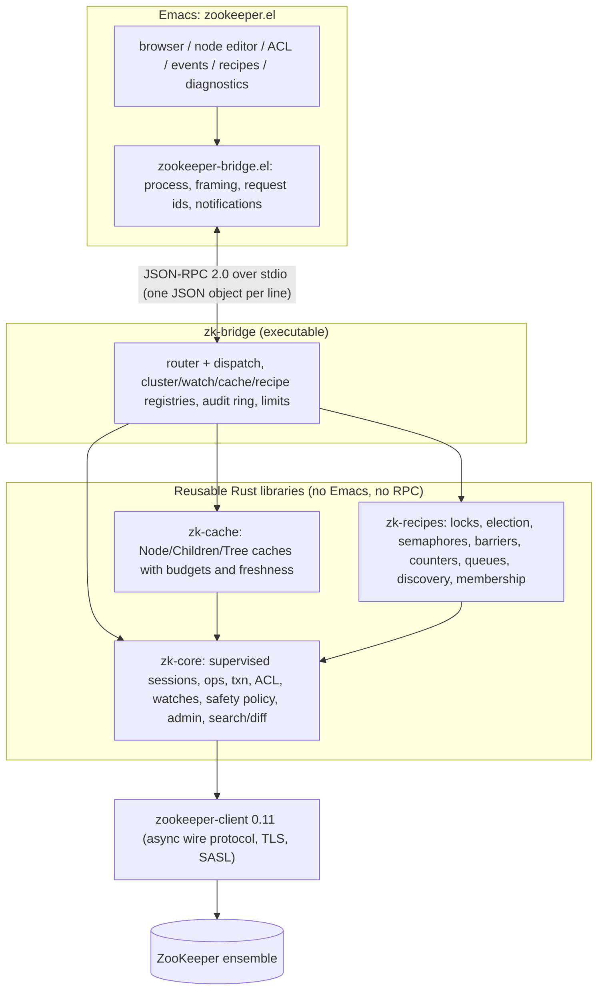

# Architecture

## Dependency rules

* `zk-core`, `zk-cache` and `zk-recipes` never depend on Emacs, JSON-RPC or
  the bridge. They are ordinary async Rust libraries, usable from a CLI, a TUI
  or other editors.
* `zk-cache` and `zk-recipes` depend only on `zk-core`. When they need a
  protocol operation that `zk-core` does not wrap, they use `Session::raw()`.
* `zk-bridge` is a thin adapter. It translates parameters and serializes
  results, and holds no domain logic. Search, diff, copy, move, recursive
  delete and the safety policy all live in `zk-core`.
* `zk-testkit` is a dev-dependency only. It launches real ZooKeeper servers
  and provides a fault-injecting TCP proxy.

## Sessions, generations and ownership

`ZkClient` is a supervisor over a sequence of ZooKeeper sessions. Each
session has a `generation` that goes up by one every time a session is
established. Plain operations use whatever session is current. Anything whose
meaning depends on session identity pins a `Session`: ephemeral nodes, locks,
leadership, recipe ownership. A pinned session never silently becomes a newer
one.

| ZooKeeper client state | `ConnectionEvent` | Effect on ownership |
| --- | --- | --- |
| connected (first time) | `connected` | `held` |
| disconnected | `suspended` | `suspended`. Callers must stop acting as owner. |
| reconnected, same session | `reconnected` | `held` again |
| expired | `lost`, then `session-reestablished` with generation + 1 | `lost` (terminal) |
| auth failed | `auth-failed` (terminal) | `lost` |
| closed | `closed` (terminal) | `lost` or `released` |

## Write semantics

* Reads are retried within a bounded policy (attempts, backoff with jitter,
  time budget).
* Writes are sent at most once. If the reply is lost (connection loss or
  deadline), the caller gets `outcome-unknown`. The write may or may not have
  been applied, and the caller must re-read before deciding what to do.
* The safety policy (read-only, protected paths, recursion limits) is checked
  locally, before anything is sent. Every mutation, including denied ones,
  produces an audit record.

## Watches and caches

Persistent watches (3.6+) are the foundation for live views. Consumers see
these events:

* `resync` after a reconnect. Events may have been missed (ZOOKEEPER-4698),
  so derived state must be rebuilt.
* `session-lost` and then `reregistered` after expiry. The watch is
  re-registered automatically on the new session.

Caches turn this into a consistent local view with an explicit freshness
state. A stale view is never presented as live.

## Bridge concurrency

Each request runs in its own task, with a configurable concurrency cap.
Requests for the same cluster go to ZooKeeper in the order they arrive, so
read-your-writes holds within a cluster. `$/cancelRequest` aborts a request. A
handler that panics turns into an internal-error response. It never leaves a
request hanging.
